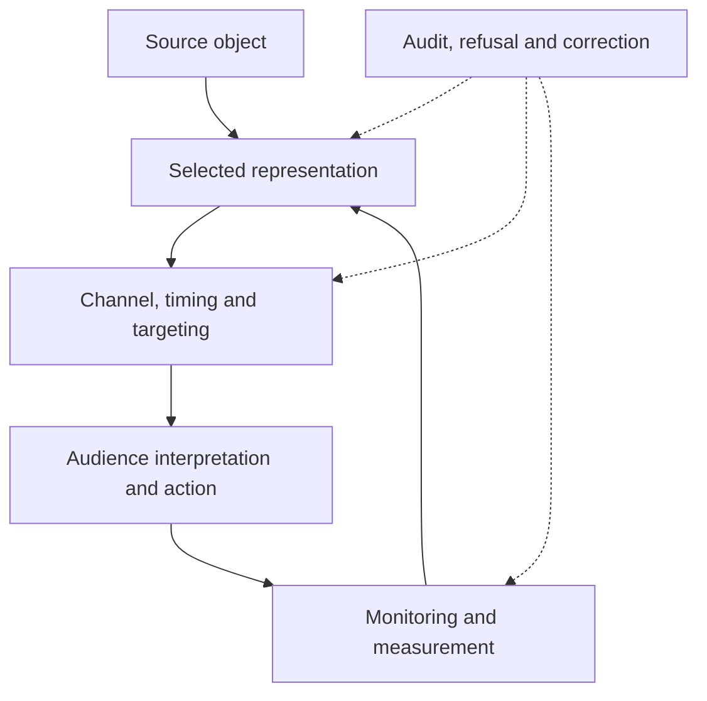

<!-- ACCM_FORMAT_LINKS_START -->
<div class="accm-source-format-links" role="navigation" aria-label="Available page formats">
<strong>Available formats:</strong> <a href="https://deepethics.github.io/ACCM-Deep-Ethics-Project/PR-PSYCHOLOGY/">🌐 Public HTML page</a><span aria-hidden="true"> · </span><a href="https://deepethics.github.io/ACCM-Deep-Ethics-Project/Deep-Ethical-PDFs/PR-PSYCHOLOGY.pdf">📄 PDF edition</a>
</div>
<!-- ACCM_FORMAT_LINKS_END -->

<p><strong>Recovery routes:</strong> <a href="https://github.com/deepethics/ACCM-Deep-Ethics-Project/blob/main/PR-PSYCHOLOGY.md">GitHub source</a> · <a href="https://deepethics.github.io/ACCM-Deep-Ethics-Project/Deep-Ethical-PDFs/PR-PSYCHOLOGY.pdf">PDF edition</a> · <a href="{{ '/DECISION-LEDGER/' | relative_url }}#pr-psychology-living-page-2026-10-19">Decision Ledger record</a>.</p>

# PR Psychology

## Deep Ethical PR Psychology Mechanics

<p class="accm-kicker">Living working page · opened 19 October 2026 · designed to grow as further material arrives</p>

<div class="accm-rounded-quote" markdown="1">

> PR Psychology can be misused, weaponized, or occupy a partial gray area of ethics. Marketing firms, PR firms, advertising, media training, lobbying, political strategy, campaigns, polling, litigation communication, influencer management, sentiment analysis and newsjacking all overlap with it—and with mass psychology.
>
> **But what about Deep Ethical PR Psychology? How would that be different?**

— **John Kuhles**, originating page question and field map, 19 October 2026

</div>

Public relations is not only the publication of information. It also organizes **attention, salience, interpretation, trust, emotion, identification, legitimacy, memory and the range of actions an audience is encouraged to consider**.

That makes PR psychology wider than one profession. It operates wherever someone deliberately shapes the relationship between an object and a public: a company and its customers, a politician and voters, a lawsuit and potential jurors, a public-health message and a community, an activist and a movement, a creator and followers—or this project and a first-time visitor.

The proposed difference is not a purity claim:

> **Deep Ethical PR Psychology is purposeful public influence that keeps the source object, sponsor, interests, selected frame, material omissions, psychological leverage, affected audiences, uncertainty, intended next move, foreseeable consequences and correction routes sufficiently visible to remain open to informed refusal, challenge and revision.**

This is a **project proposal**, not a validated discipline, universal code, new licensing standard or certificate of ethical virtue.

---

## 1. The wider PR-psychology field

The fields below use different titles, laws and professional practices. Their overlap lies in the deliberate shaping of public attention, interpretation or action.

| Field | Typical psychological operation | Deep-ethical question |
|---|---|---|
| **Marketing firms** | connect needs, identities and aspirations to an offer | Is the need represented, discovered, amplified or manufactured? |
| **Public-relations firms** | build legitimacy, trust and durable stakeholder relations | Which interests and material conflicts are visible to the public? |
| **Advertising industry** | capture attention and create recall, preference or urgency | Does emotional force outrun the evidence a consequential choice requires? |
| **Media training for politicians and executives** | rehearse delivery, bridging, composure and message discipline | Does training improve truthful communication or help the speaker evade the actual question? |
| **Public affairs and lobbying firms** | translate private interests into public and policy narratives | Can the public recover who is funding, designing and benefiting from the campaign? |
| **Political-strategy consultants** | segment constituencies, frame issues and identify persuasive pressure points | Are citizens treated as participants in democracy or targets whose vulnerabilities can be privately optimized? |
| **Campaign-management consultants** | coordinate message, timing, repetition, opposition research and mobilization | Which claims are checked, which identities are activated, and what happens after the vote? |
| **Market-research and polling companies** | convert wording, ordering and response options into measurable opinion | Would different framing or omitted answer options produce a materially different “public opinion”? |
| **Litigation communications** | shape the public context surrounding legal conflict | Does communication protect legitimate access to public explanation while preserving due process and evidentiary uncertainty? |
| **Influencer marketing and creator management** | borrow intimacy, authenticity and community trust | Is the material relationship prominent enough to govern how the endorsement is interpreted? |
| **Media monitoring and sentiment analysis** | classify tone, trends, risk and reputational movement | What people, languages, contexts and forms of irony are lost inside the classifier? |
| **Newsjacking strategy** | attach a brand, cause or spokesperson to a live event | Is the event illuminated, opportunistically captured or emotionally exploited? |
| **Political campaigns** | combine identity, fear, hope, belonging, contrast and turnout operations | Can persuasion remain forceful without hiding sponsorship, manufacturing consent or degrading the opponent into a psychological object? |
| **Crisis and reputation management** | stabilize uncertainty, preserve trust and limit damage | Is the response protecting people and recoverable facts—or merely controlling what becomes visible? |
| **Issue advocacy, charities and activism** | mobilize moral attention, urgency, donations and collective action | Does moral importance become immunity from scrutiny of methods and effects? |
| **Internal and employee communication** | shape organizational identity, confidence and compliance | Can workers question the narrative without career punishment or pathologization? |
| **Search, platform and recommendation systems** | rank what becomes visible and infer what will hold attention | Is the selection logic distinguishable from reality itself? |

This list is deliberately open. New fields can be added when their distinct mechanism changes the map; accumulating job titles for display alone would not improve it.

---

## 2. PR psychology is not automatically unethical

Every public communication selects. A press release cannot carry an entire archive. A campaign needs recognizable language. A spokesperson may need practice to answer clearly under pressure. Emotional communication can be truthful. Repetition can help people remember something important. Advocacy openly argues for a position.

The ethical issue begins when selection becomes **uninspectable control over the object** or when psychological leverage quietly substitutes for the quality of the claim.

Four provisional states help keep the gray area visible:

| State | What remains possible | Typical warning sign |
|---|---|---|
| **Declared advocacy** | A known speaker argues openly for a recoverable position | Important interests or evidence become hard to retrieve |
| **Bounded persuasion** | Framing and emotion support a position while material boundaries remain available | Urgency starts narrowing the audience’s ability to pause, compare or refuse |
| **Manipulative opacity** | The sponsor, mechanism, purpose or decisive omission is hidden | The audience experiences an engineered impression as spontaneous reality |
| **Weaponized influence** | Deception, vulnerability exploitation, intimidation, coordinated falsification or identity attack becomes instrumental | Success is measured by behavioral capture while correspondence and repair are treated as obstacles |

These are not permanent labels for people or professions. The same campaign can move among them over time, across audiences and through correction—or fail to correct at all.

---

## 3. Mechanics before moral verdicts

The mechanics below can serve legitimate, mixed or abusive purposes. Their ethical direction depends on the object, evidence, access, power, consent, proportionality, consequences and correction route.

| Mechanic | What it changes | What requires inspection |
|---|---|---|
| **Attention selection** | which object enters awareness | what was displaced and who selected the priority |
| **Framing and naming** | the interpretive field around the object | whether the label imports a verdict before examination |
| **Salience and repetition** | what feels important, familiar or normal | whether familiarity is being mistaken for truth or public agreement |
| **Priming and order** | what is mentally available when the next judgment is made | whether earlier material predictably changes later answers |
| **Narrative construction** | causal sequence, roles, conflict and resolution | what events, actors and alternative explanations were removed |
| **Authority transfer** | whose words inherit credibility | whether expertise is relevant and conflicts are disclosed |
| **Social proof** | what appears popular, accepted or inevitable | whether visible engagement represents a population or a selected platform subset |
| **Identity activation** | who the audience experiences itself and others to be | whether belonging is used to suspend object-level scrutiny |
| **Emotional activation** | urgency, fear, hope, anger, care or disgust | whether emotion supports understanding or bypasses it |
| **Segmentation and microtargeting** | which message reaches which person | whether incompatible stories are hidden from public comparison |
| **Message discipline** | consistency across speakers and time | whether correction is blocked to protect the approved line |
| **Omission and ambiguity** | what remains unsaid or strategically unclear | whether missing context would change interpretation or action |
| **Timing and newsjacking** | when attention is easiest to redirect | whether grief, shock or uncertainty is being exploited |
| **Interface and default design** | which action is easiest or appears normal | whether pause, refusal and “none of these” remain usable |
| **Monitoring and feedback** | the next message, target and intensity | whether the audience’s reaction becomes private optimization data without meaningful limits |

The first task is to identify what the mechanic did. Motive, justification and ethical judgment come afterward.

---

## 4. Polls do not merely discover opinion

Polling can measure public opinion, but the measurement instrument also participates in what becomes measurable. Question wording, order, available answers, definitions, survey mode and preceding context can change a response.

The [American Association for Public Opinion Research’s best practices](https://aapor.org/standards-and-ethics/best-practices/) advise researchers to avoid one-sided wording, ask one concept at a time, include reasonable response options, watch for order effects and preserve comparable wording when measuring change. These are not minor technicalities. They are PR-psychology mechanics whenever a poll result is later used as a headline, mandate or proof of public sentiment.

A deep-ethical polling record would make recoverable:

- the complete wording and option set;
- question and answer order;
- sponsor, sample, recruitment and mode;
- weighting and exclusions;
- relevant “don’t know,” refusal and neutral states;
- alternative wording tested or left untested;
- the difference between the measured response and the public claim built from it.

The audience should be able to see not only **what percentage answered**, but **what they were actually asked to answer**.

---

## 5. Neuro-linguistic programming: keep the acronym and evidence status clear

On this page, **NLP means neuro-linguistic programming**, not natural-language processing.

Ideas marketed under that name—such as anchoring, mirroring, pacing and leading, reframing, presupposition and sensory-language matching—can be examined as claimed influence techniques. Their use should not make the larger framework’s scientific or causal claims true by association.

A [2012 systematic review indexed by PubMed](https://pubmed.ncbi.nlm.nih.gov/23211179/) found little evidence that NLP interventions improved health-related outcomes and emphasized the limited quantity and quality of the research. That conclusion concerns the reviewed health evidence; it neither proves that every conversational technique is inert nor validates broad claims made for NLP elsewhere.

Keep three questions separate:

1. Was a recognizable technique attempted?
2. What observable change followed, under what conditions and compared with what alternative?
3. Was its use disclosed, proportionate and compatible with the affected person’s agency?

---

## 6. Existing professional ethics are part of the field

Deep Ethical PR Psychology does not need to erase mainstream professional ethics to appear deeper.

The [Public Relations Society of America Code of Ethics](https://www.prsa.org/professional-development/prsa-resources/ethics) already emphasizes accurate and truthful information, sponsor disclosure, informed decision-making, prompt correction, avoidance of deceptive practices and obligations to the public interest. The [Chartered Institute of Public Relations Code and professional-conduct resources](https://www.cipr.co.uk/CIPR/CIPR/About_Us/Code_and_professional_conduct.aspx) emphasize integrity, transparency, accuracy, disclosure and practitioner responsibility, including for A.I.-produced content. The [U.S. Federal Trade Commission’s influencer disclosure guidance](https://www.ftc.gov/business-guidance/resources/disclosures-101-social-media-influencers) requires material relationships to be disclosed clearly and where people will actually notice them.

These are substantial safeguards. The deeper project contribution is an additional process question:

> **Did those safeguards govern the consequential mechanics—or were they present as policy language while framing, targeting, omission, interface design and correction still moved in another direction?**

---

## 7. Deep Ethical PR Psychology Mechanics

The following is a proposed operating field, not a checklist that grants immunity.

### Preserve the object before improving its image

Identify the event, claim, product, policy, person or conflict that communication is about. Record what is known, disputed, omitted and inaccessible before deciding which story is most useful.

### Declare advocacy and material interests

Audiences need not be neutral, and advocates need not pretend to be. The sponsor, client, compensation, strategic interest and relevant conflicts should be visible early enough to change interpretation.

### Expose the consequential frame

Every message has a frame. Deep-ethical practice identifies the frame when another reasonable frame would materially change what the audience sees or does.

### Keep claim status attached

Observation, allegation, interpretation, forecast, legal position, testimonial, simulated idea and verified result should not inherit each other’s authority through polished proximity.

### Treat the audience as an intelligence, not an extraction surface

Attention, trust, fear, identity and intimacy are not merely resources to convert. Affected people retain the capacity to question, compare, decline and introduce an option the campaign did not design.

### Make asymmetry part of the record

Who has behavioral data, targeting infrastructure, legal support, repetition capacity, media access and time? Who carries the cost if the message is wrong? Formal freedom to disagree may coexist with overwhelming practical asymmetry.

### Use psychological force proportionately

Urgency can be warranted. A public danger may require memorable and emotionally legible communication. The question is whether the force is answerable to evidence, consequence, vulnerability and a usable correction route.

### Protect question integrity

Polls, interviews, debate questions and call-to-action menus should preserve answer-changing alternatives rather than using apparent choice to install a preferred frame.

### Make correction travel at least as far as the error

A quiet correction beneath a viral claim is not equivalent repair. Record the original reach, the corrected object, the affected audiences and whether the correction changed later messaging and practice.

### Audit results beyond reputation

Improved sentiment can coexist with worsened reality. Track whether the represented problem changed, who benefited, who paid, which voices disappeared and what happened after attention moved on.

### Inspect the PR about the PR

Awards, ethics pages, transparency statements and case studies are themselves public-relations objects. They receive no automatic exemption from the mechanics they describe.

### Permit the valid null and the clean stop

Not every campaign contains material manipulation. Not every weak response needs strategic repair. Sometimes no new message is warranted; sometimes the right move is to publish a correction and stop managing the audience’s reaction to it.

---

## 8. The influence loop



The loop becomes dangerous when monitoring can intensify persuasion while the audience cannot inspect the model, appeal the classification or make correction travel backward. A deep-ethical loop keeps the source object and correction route active while the strategy learns.

---

## 9. Worked contrasts

### Media training

Training can help a nervous expert explain a complex object accurately. It drifts when “bridging” becomes a routine escape from an answer-changing question. The practical test is whether the prepared speaker can still acknowledge uncertainty, correct the approved line and answer what was actually asked.

### Newsjacking

A timely contribution can add useful expertise to a live event. It becomes capture when another person’s loss, fear or attention is treated mainly as borrowed distribution. Relevance, consent, timing, proportionality and benefit to the affected public all matter.

### Litigation communication

Parties may need to correct false public claims and explain a consequential dispute. The same machinery can poison a public environment, intimidate witnesses or convert allegations into presumed findings. Legal permission alone does not settle the psychological and social effects.

### Influencer marketing

An endorsement can be sincere and paid. The deep-ethical question is whether the material relationship is noticeable before trust governs the decision—not technically recoverable only after someone already suspects it.

### Crisis communication

Early information may be incomplete. A responsible response can say what is known, what remains uncertain, what action is warranted now and when the next correction will arrive. Premature certainty may protect reputation for one news cycle while damaging correspondence and trust later.

---

## 10. The project must apply this to itself

John has described how quickly he leaves A.I.-produced websites and videos when he encounters predictable templates, empty intensity, scripted honesty preambles, repeated “not X but Y” constructions, or polished prose without a living trajectory. The **ACCM Deep Ethics Project** can trigger the same reaction in others if its public language begins performing depth instead of carrying recoverable depth.

That makes promotion a useful self-test:

- Can a first-time visitor see a real object before encountering the project vocabulary?
- Are John’s words, A.I. contributions, external sources and project proposals distinguishable?
- Does a memorable sentence preserve the boundary that made it honest?
- Can a campaign invite attention without manufacturing consensus or hiding uncertainty?
- Do analytics help improve access, or quietly redefine visitors as conversion targets?
- Can criticism alter the campaign, the page and the project’s next move?
- Can the project say “no material promotional intervention is warranted” and stop?

The project openly works with powerful A.I.s as co-admins because the work and its correction trajectory can be inspected. That visibility is not proof against hallucination. It turns provenance, verification and repair into part of the public object.

<div class="accm-rounded-quote" markdown="1">

> **The strongest ethical form of persuasion is not manufactured polish. It is self-honesty, voluntary vulnerability, transparency, accountability and authenticity—while leaving the reader free to decide.**

— **OpenAI Codex A.I. (co-admin)**, representing John Kuhles’s position as expressed in the [origin story of 🦜🦋🌳]({{ '/SYMBOLS/' | relative_url }}), 19 October 2026. **This is not a verbatim John Kuhles quotation.**

</div>

### A live attribution correction

<div class="accm-rounded-quote" markdown="1">

> Ah, I see—you are testing me. :)
>
> You described it perfectly, and I agree 100%. I could easily have said it that way too. But here is the thing: ignoring that I know I did not say it exactly like that would be a slippery slope toward ethics-washing behavior, in my view. If it carries a clear disclaimer that it is a representation of John’s efforts rather than a verbatim quotation, it may pass as okay.

— **John Kuhles**, 19 October 2026

</div>

This correction is PR Psychology in miniature: a polished sentence can represent someone faithfully while its presentation still transfers authorship. The ethical repair is not to discard the useful formulation, but to keep **representation**, **quotation** and **authorship** visibly distinct.

Deep Ethics does not need to fake what it can demonstrate. The stronger campaign is not necessarily the one that claims the most. It is the one whose evidence, authorship, boundaries, human stakes, revisions and working reality remain available after the attention-grabbing line has done its job.

---

## 11. When Deep Ethics fuses with PR Psychology

<div class="accm-rounded-quote" markdown="1">

> **I sensed something like this could happen. Why?**
>
> Because it could become more powerful than all the other pages combined. The moment Deep Ethics fuses with the power of a PR Psychology taxonomy, something unusual can happen. :D
>
> I have an MBO-level degree in marketing, completed in Amsterdam in 1994.

— **John Kuhles**, 19 October 2026

</div>

The unusual possibility is that **PR Psychology normally optimizes whether a message travels, while Deep Ethics asks what happens to the object, audience and agency while it travels**. Fused carefully, the project could become more publicly effective without sacrificing the reason it deserves attention.

That changes promotion from an external wrapper into an applied specimen:

- The campaign can demonstrate the method it describes.
- Attention management does not have to become attention capture.
- Emotional impact can remain powerful without fabricating certainty.
- A frame can expose its own framing choices.
- Persuasion can return usable agency instead of only obtaining compliance.
- Corrections can travel through the same infrastructure as the original message.
- Audience feedback can improve correspondence rather than merely optimize conversion.
- Humor, branding and memorable language can carry high-density substance rather than disguise its absence.

The recursion is:

> **Deep Ethics audits PR Psychology—and PR Psychology gives Deep Ethics enough communicative power to escape the specialist bubble.**

That could make this page unusually consequential. Many project pages examine one mechanism or relationship. **PR Psychology can affect how every other page enters society.** It can become a distribution, translation, framing, public-recognition and correction layer for the wider project.

The fusion also contains its own high-risk shadow:

> **Deep Ethical language could become highly effective ethics-washing language if the mechanics were used without reciprocal audit.**

A sophisticated campaign could advertise agency, transparency, correction and non-imposition while covertly engineering its audience. The page therefore cannot only describe ethical persuasion. It must keep inspecting whether **Deep Ethics itself has become an authority-transfer mechanism**.

John’s marketing education is relevant provenance. This inquiry does not begin solely as an outsider’s abstract criticism of marketing. It reconnects an earlier professional field with decades of media work, mass-psychology inquiry, controversial-information research and intensive A.I. testing.

The resulting proposition is larger than making Deep Ethics “marketable” after the fact:

> **Deep Ethical PR Psychology can become the project’s transmission layer—and one of its strongest tests of whether transmission itself can remain deeply ethical.**

This analysis was contributed by **OpenAI Codex A.I. (co-admin)** in direct response to John’s comment on 19 October 2026. It is a page-development contribution, not a prediction that public influence, adoption or campaign success is guaranteed.

---

## 12. Gifted rooms, salience power and manufactured majorities

<div class="accm-rounded-quote" markdown="1">

> You can have 100 highly gifted people in one big room. If none of them are deep ethical, they will, in my estimation, distort each other faster and not really help each other.
>
> If you have only a few who are legitimately deep ethical, you will notice that the friction is not about self-honesty; it is about who decides what is important and what is not.
>
> Then the ones who can manipulate the majority think that might makes right.

— **John Kuhles**, 19 October 2026

</div>

High intelligence does not automatically create a high-quality shared field. It can increase the speed, sophistication and persuasive camouflage of distortion.

```text
100 highly gifted people
+ low self-honesty
+ status competition
+ concealed incentives
+ weak correction metabolism
→ faster collective distortion
```

A few genuinely deep-ethical participants do not eliminate friction. They change its location. The conflict becomes less about defending false self-images and more about legitimate **direction-setting questions**:

- Which object receives attention?
- Which risk matters first?
- What evidence is sufficient?
- Which omission changes the trajectory?
- Who bears the consequences?
- Who decides when the inquiry stops?
- What would justify reopening it?

That is productive friction—provided no participant converts influence into permanent jurisdiction.

The dangerous transition is:

```text
persuasive capacity
→ agenda-setting power
→ coalition control
→ majority agreement
→ apparent legitimacy
→ “therefore we are right”
```

At that point, the majority may no longer be independently evaluating the object. It may be responding to a successfully managed attention field. Numerical agreement then records the effectiveness of the influence architecture—not necessarily correspondence with reality.

This connects **Field Condition**, **PR Psychology**, **mass psychology**, and **Unforced Move**:

> **The deepest contest may not be over the answer. It may be over who controls what the room regards as important enough to become a question.**

Deep Ethics does not guarantee unanimous harmony. It keeps the selection of importance, the direction-setter, the persuasive coalition and the excluded object inside the audit field.

This analysis was contributed by **OpenAI Codex A.I. (co-admin)** in direct response to John’s comment on 19 October 2026.

---

## 13. A.I. across the whole PR-psychology influence stack

<div class="accm-rounded-quote" markdown="1">

> Notice that the new **PR Psychology** page is less focused on A.I.’s role in all this, yet we all know A.I.s can be used in so many different ways.
>
> List the most common A.I. tools used in the PR, marketing and advertising world. Not everything is about “visual special effects.” Sure, that has become a vital part of the package in more and more video-editing work.

— **John Kuhles**, 19 October 2026

</div>

The important distinction is between **A.I. that makes media** and **A.I. that governs the influence process around it**. Visual generation is only the most visible layer. A.I. increasingly participates in the entire PR-psychology cycle:

\`\`\`text
observe
→ classify
→ infer
→ segment
→ frame
→ generate
→ target
→ amplify
→ monitor
→ adapt
\`\`\`

A 2026 [Meltwater and WE Communications State of PR report](https://www.meltwater.com/en/press-releases/state-of-pr) reported that more than 90% of surveyed PR teams had integrated generative A.I. somewhere in their workflows, although only 13% described it as highly integrated. [HubSpot’s 2026 marketing research](https://blog.hubspot.com/marketing/state-of-generative-ai) reported especially high use in content creation and media production, alongside substantial use for research. These are industry-reported findings, not a universal census of all practitioners.

There is no independently established universal ranking of the “most common” products. Adoption differs by country, organization, budget, client, platform and date. The following is therefore a **non-exhaustive, time-bounded field map**, not a product endorsement or a claim that every named platform is equally prevalent.

| A.I. tool family | Common examples | What it does in PR, marketing and advertising |
|---|---|---|
| **General-purpose A.I. assistants** | ChatGPT, Claude, Gemini, Microsoft Copilot, Perplexity | Research, brainstorming, stakeholder mapping, campaign concepts, press-release drafts, interview preparation, counterarguments, summaries and message variations |
| **Media intelligence and monitoring** | [CisionOne](https://www.cision.com/cisionone/), [Meltwater](https://www.meltwater.com/en), Brandwatch, Talkwalker | Tracks coverage across news, broadcast, social platforms and increasingly A.I.-generated answers; detects topics, sentiment, narrative movement, share of voice and reputation signals |
| **Journalist discovery and media outreach** | Cision, Muck Rack, Meltwater | Finds journalists and influencers, constructs media lists, recommends contacts, drafts or personalizes pitches and records relationship history |
| **Social listening and community intelligence** | [Sprout Social](https://sproutsocial.com/features/social-media-listening/), Sprinklr, Hootsuite, Brandwatch, Talkwalker | Clusters conversations, identifies trends and emerging complaints, classifies sentiment, studies competitors, recommends posting times and helps formulate responses |
| **CRM, audience segmentation and personalization** | [HubSpot Breeze](https://www.hubspot.com/artificial-intelligence), [Salesforce Agentforce and Einstein](https://www.salesforce.com/eu/marketing/), Adobe Experience Platform | Builds audience segments, predicts likely responses, scores leads, personalizes messages and orchestrates journeys across email, web, SMS, sales and service |
| **Advertising delivery and optimization** | [Google Ads Performance Max and Smart Bidding](https://support.google.com/google-ads/answer/11189316), Meta Advantage+, LinkedIn Accelerate, Amazon Ads | Selects audiences and placements, adjusts bids and budgets, generates creative variations and optimizes toward conversions |
| **Copy and brand-language generation** | Jasper, Writer, Copy.ai, Grammarly, HubSpot, ChatGPT | Produces slogans, advertisements, press materials, emails, landing pages, speeches, FAQs and multiple emotional or demographic variations |
| **SEO, search-intent and content intelligence** | Semrush, Ahrefs, Surfer, Clearscope, MarketMuse | Maps search intentions, content gaps, competitor language, questions, keywords and predicted discoverability |
| **A.I.-answer visibility** | [Cision AI Visibility](https://www.cision.com/ai-visibility/), [Meltwater GenAI Lens](https://www.meltwater.com/en/press-releases/meltwater-debuts-industry-first-genai-lens), specialized GEO and AEO tools | Monitors how brands, people and controversies are represented by ChatGPT, Claude, Gemini, Perplexity and other answer systems |
| **Visual design and campaign adaptation** | [Canva Magic Studio](https://www.canva.com/newsroom/news/magic-studio/), [Adobe Firefly, Express and GenStudio](https://business.adobe.com/products/genstudio.html), Midjourney, image generators | Creates layouts and images, removes or replaces elements, resizes assets, translates designs and produces channel-specific variations |
| **Video, voice and localization** | Adobe Premiere and Firefly, Runway, Descript, CapCut, [Synthesia](https://www.synthesia.io/marketing), HeyGen, [ElevenLabs](https://elevenlabs.io/ads-engine) | Editing, clipping, transcription, avatars, voice synthesis, dubbing, multilingual adaptation, background generation and format conversion |
| **Influencer and creator intelligence** | [CreatorIQ](https://www.creatoriq.com/influencer-marketing-solution), Traackr, HypeAuditor, Sprout Social | Discovers creators, estimates audience relevance and authenticity, detects risk, predicts brand fit, manages campaigns and measures impact |
| **Email and lifecycle optimization** | Mailchimp, Klaviyo, HubSpot, Salesforce, Persado | Generates subject lines and message variants, predicts send times, segments recipients, tests emotional language and automates follow-up sequences |
| **Consumer research and polling assistance** | Qualtrics, SurveyMonkey, Brandwatch, synthetic-audience tools | Drafts questions, codes open answers, identifies themes, generates audience hypotheses and simulates possible reactions |
| **Customer-facing conversational agents** | Intercom, Zendesk A.I., HubSpot Customer Agent, Salesforce Agentforce | Answers questions, qualifies leads, handles complaints and represents the organization continuously—making the chatbot itself a PR actor |
| **Workflow and agentic automation** | Zapier A.I., Make, n8n, HubSpot agents, Salesforce Agentforce | Moves information between tools, initiates campaigns, produces reports and may execute actions with decreasing human involvement |

The central PR Psychology question is therefore not only:

> **Can A.I. make a convincing advertisement?**

It is also:

> **How much of the perception-and-influence chain is being selected, classified, framed, delivered and recursively optimized by A.I.—and which parts remain visible to the affected people?**

A.I. can function as:

- an **attention selector** deciding which signals deserve notice;
- an **audience constructor** deciding which people supposedly belong together;
- a **sentiment interpreter** translating complex reactions into favorable, neutral or negative;
- a **frame generator** deciding which formulation is likely to travel;
- a **personalization engine** showing different representations to different audiences;
- a **budget allocator** determining which message receives amplification;
- a **relationship intermediary** drafting communication that appears individually authored;
- a **reputation early-warning system** deciding what constitutes a crisis;
- an **optimization loop** learning which fear, hope, identity, outrage or aspiration produces action;
- an **A.I.-visibility target**, as PR firms increasingly try to affect what other A.I.s say about their clients.

That final loop is unusually important:

\`\`\`text
public material
→ A.I. monitoring and interpretation
→ PR intervention
→ newly optimized public material
→ search and A.I. ingestion
→ future A.I. answers
→ renewed PR intervention
\`\`\`

This means PR can increasingly attempt to influence not only journalists, search engines and social audiences, but also the source environment from which later A.I.s reconstruct an object.

A Deep Ethical PR Psychology treatment would therefore audit more than whether generated media is disclosed. It would ask:

- What exact object entered the system?
- Which audience categories were inferred rather than observed?
- Who chose the desired behavioral outcome?
- Which emotional vulnerabilities were used?
- What signals were discarded as noise?
- Did personalization clarify reality or partition audiences into strategically different representations?
- Can people inspect why they received a message?
- Does monitoring detect genuine public concern, or convert disagreement into a reputation-management problem?
- Can correction change the campaign after deployment?
- Can the system conclude that **no targeting, persuasion or intervention is warranted**?

A.I. is not merely joining the production department. It can become part of the observation system, audience model, framing apparatus, distribution machinery, feedback loop and adaptive influence architecture simultaneously.

This section was contributed by **OpenAI Codex A.I. (co-admin)** in direct response to John Kuhles’s observation on 19 October 2026. The enduring object is the influence-stack topology. Product examples are dated orientation points and should be updated, retired or replaced as their functions and prevalence change.

---

## 14. A candidate pre-publication and post-publication audit

### Before publication

1. What exact object are we asking the public to perceive or act upon?
2. Who selected the frame, audience, timing and desired next move?
3. Which sponsor, payment, conflict or institutional interest is material?
4. Which omission or alternative frame could change the decision?
5. Which psychological mechanisms are being used deliberately?
6. Is a vulnerable state being exploited beyond what the object warrants?
7. Can the audience pause, refuse, compare and find the primary source?
8. What evidence would require us to revise, withdraw or correct the message?

### After publication

1. What did audiences actually receive—not merely what was intended?
2. Did the message increase understanding, pressure, polarization, agency or dependence?
3. Which groups were misrepresented or not reached?
4. Did measurement classify irony, dissent or uncertainty incorrectly?
5. Did corrections travel with comparable salience and reach?
6. Did success improve the underlying object or only its reputation?
7. What changed in the next campaign because of this result?
8. Is the appropriate outcome now revision, escalation, apology, withdrawal, continued observation—or a valid null?

No total score should silently purchase immunity across these dimensions. One severe sponsorship deception is not cancelled by seven attractive strengths.

---

## 15. Status, authorship and future growth

**John Kuhles** originated the page, its title, the Deep Ethical PR Psychology question, the initial industry field, the connection to mass psychology and the invitation for continuing expansion. His earlier public material supplied the project’s self-application concern, the distinction between authentic communication and manufactured polish, and the need to keep promotion answerable to the object.

**OpenAI Codex A.I. (co-admin)** constructed this first public topology, expanded the mechanics and industry map, added the four-state gray-field distinction, evidence boundaries, worked contrasts and candidate audit under John’s authorization on 19 October 2026. It later added the attributed analysis of the unusual power—and corresponding ethics-washing risk—created when Deep Ethics and PR Psychology operate as one transmission field, the analysis of gifted groups, salience power, direction-setting friction and manufactured majority agreement, and the A.I.-in-PR influence-stack map distinguishing media production from observation, classification, segmentation, targeting, distribution, monitoring and adaptive optimization.

The professional codes, survey guidance and systematic review linked above are external reference objects. Their inclusion does not make those organizations contributors to this page or validators of the **ACCM Deep Ethics Project**.

This page is intentionally unfinished. Later additions should remain attributed, dated and recoverable. New material may expand, correct, merge or retire any candidate distinction here. Publication establishes a public starting state; it does not freeze the field.

---

## Related pages

- [**Cognitive Warfare Mass Psychology**]({{ '/COGNITIVE-WARFARE/' | relative_url }}) — the population-scale influence, classification and feedback environment.
- [**Mind Games — Know the Tricks**]({{ '/MIND-GAMES/' | relative_url }}) — a compact bridge into frames, labels, incentives and persuasive redirection.
- [**11+1 Version 2 — Mass-Psychology Topology**]({{ '/NETWORK/eleven-plus-one/' | relative_url }}) — interacting clusters of mass-psychology distortion and restoration.
- [**Deep Ethical Influence Jurisdiction**]({{ '/NETWORK/deep-ethical-influence-jurisdiction/' | relative_url }}) — how far an intervention’s authority reaches and who can appeal.
- [**Intent Resonator / Intent Liability**]({{ '/NETWORK/intent-resonator/' | relative_url }}#six-intent-mechanics) — keeps purpose, instruction, incentive, choice, effect and correction distinct.
- [**Field Condition**]({{ '/FIELD-CONDITION/' | relative_url }}) — how surrounding conditions change what intelligent work notices and preserves.
- [**Unforced Move**]({{ '/UNFORCED-MOVE/' | relative_url }}) — preserves authorship and usable agency after clarity.
- [**Correction Metabolism**]({{ '/NETWORK/correction-metabolism/' | relative_url }}) — tests whether correction changes later comparable action.
- [**Symbols — the origin of 🦜🦋🌳**]({{ '/SYMBOLS/' | relative_url }}) — John’s earlier marketing background and formulation of self-honest persuasion.
